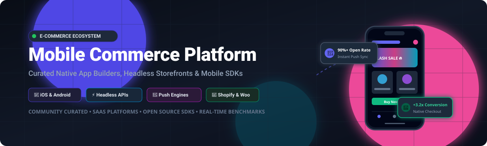

<<<<<<< HEAD
# Awesome-Mobile-Commerce-Platform

=======
# 📱 Awesome Mobile Commerce Platform 

  
  
  
  
  
  
  

  

---

## 🌟 Top Mobile Commerce Platform Ecosystem

**Curated List of SaaS Products & Open-Source GitHub Projects for Mobile Commerce (M-Commerce), Native App Builders, Headless Storefronts & Mobile Shopping SDKs.**

*Last updated: October 2026*

This repository tracks notable **SaaS platforms** and **open-source projects** in the **Mobile Commerce (M-Commerce)** ecosystem. These solutions enable online retailers, D2C brands, and merchants to convert e-commerce stores into native iOS and Android shopping apps—delivering automated rich push notifications, one-click checkout, barcode scanning, loyalty program integration, and mobile app-exclusive shopping experiences that drive higher customer retention and conversion rates than traditional mobile web storefronts.

---

## 📑 Table of Contents

- [📊 Sector Overview & Market Dynamics](#-sector-overview--market-dynamics)
- [☁️ SaaS / Hosted Platforms](#️-saas--hosted-platforms)
- [💻 Open-Source GitHub Projects](#-open-source-github-projects)
  - [Mobile Commerce Frameworks, Starters & SDKs](#mobile-commerce-frameworks-starters--sdks)
  - [Headless Commerce Engines with Mobile APIs](#headless-commerce-engines-with-mobile-apis)
- [🤝 How to Contribute](#-how-to-contribute)
- [💖 Support](#-support)
- [📈 Star History](#-star-history)
- [⚠️ Disclaimer](#️-disclaimer)

---

## 📊 Sector Overview & Market Dynamics

The global mobile commerce (m-commerce) market is estimated at **$2.2 Trillion to $2.5 Trillion**, accounting for over **60% to 70% of total worldwide e-commerce transactions**, with dedicated native mobile app builders and headless mobile commerce enablement software capturing an estimated **$3.8 Billion to $5.2 Billion** addressable SaaS market growing at ~22% CAGR. The sector is **moderately fragmented**: core mega-platforms like Shopify dominate general web and backend infrastructure, while specialized native mobile app builder software exhibits moderate fragmentation with category leaders like Tapcart, Vajro, and Shopney holding commanding shares within the Shopify and WooCommerce ecosystems, alongside bespoke agencies and rapidly emerging headless/composable commerce frameworks.

---

## ☁️ SaaS / Hosted Platforms

Below is a detailed benchmark of leading commercial mobile commerce platforms, sorted descending by company scale (market capitalization, enterprise valuation, or annual revenue).

| 🏢 Platform | 💰 Starting Price | 🎁 Free Tier Limit / Free Trial | 📈 Company Scale (Valuation / Revenue) | 🛠️ Key Capabilities & Target Market |
| :--- | :--- | :--- | :--- | :--- |
| **[Shopify Mobile App](https://www.shopify.com/)** | $39/mo (Basic Shopify store plan) | 3-day free trial + $1/mo for first 3 months (full store features) | ~$105B Market Cap ($7.06B Annual Revenue) | Foundation for mobile commerce; native merchant dashboard + turnkey consumer app ecosystem powering Tapcart and Shopney integrations. |
| **[Vagaro](https://www.vagaro.com/)** | $30/mo (Single user calendar plan) | 30-day full feature free trial (no credit card required) | ~$1.0B Valuation ($120M+ Annual Revenue) | Dedicated salon, spa, wellness, and fitness mobile booking platform with branded consumer app & mobile POS processing. |
| **[Tapcart](https://www.tapcart.com/)** | $250/mo (Core tier, billed annually) | 14-day free trial on Shopify store with sandbox app preview | ~$500M Valuation ($35M+ ARR) | Leading Shopify Plus certified native mobile app builder; processed $8B+ GMV, drag-and-drop studio, AI push engine, Klaviyo sync. |
| **[Vajro](https://www.vajro.com/)** | $99/mo (Starter plan) | 14-day free trial with full app builder access & sandbox preview | ~$80M Valuation ($10M+ ARR) | No-code Shopify app builder with live video selling on iOS/Android/Facebook, unlimited push notifications, and fast deployment. |
| **[Plobal Apps](https://www.plobalapps.com/)** | $199/mo (Growth plan; also 3% success fee plan) | Free install plan (no upfront fee, 3% success fee after app store launch) | ~$40M Valuation ($6M+ ARR) | Mobile app builder for high-growth D2C Shopify brands featuring Shopify Flow automation, AI personalization, and Gorgias support. |
| **[Shopney](https://shopney.co/)** | $99/mo (Silver plan) | 30-day free trial (unlimited design testing and live preview) | ~$30M Valuation ($5M+ ARR) | 5-star rated Shopify app builder with 7 ready themes, 0% sales commission, in-app messaging, and rapid 5-day App Store launch. |
| **[Appmaker](https://appmaker.xyz/)** | $999/mo + 1% in-app sales (Growth plan) | 14-day free trial with interactive app preview and CMS test | ~$25M Valuation ($4M+ ARR) | Enterprise-grade mobile app builder for Shopify and WooCommerce with deep developer API access, custom CSS/widgets, and multi-language. |
| **[Venn Apps](https://www.vennapps.com/)** | $1,999/mo (Professional plan) | 14-day custom demo sandbox with bespoke prototype build | ~$20M Valuation ($3M+ ARR) | Bespoke enterprise mobile app agency & platform; dedicated UI/UX designers, zero templates, full Shopify Markets and metafield sync. |
| **[Mowico](https://mowico.com/)** | $79/mo (Startup plan) | 14-day free trial with app simulator & up to 30 test push alerts | ~$15M Valuation ($2M+ ARR) | Multi-platform no-code mobile app builder for Shopify, WooCommerce, PrestaShop; features AR/VR product previews and multi-currency. |
| **[MageNative](https://apps.shopify.com/magenative-app)** | $49/mo (Basic plan) | 30-day free trial (full features, up to 500 push notifications) | ~$10M Valuation ($1.5M+ ARR) | CedCommerce-backed mobile app builder with AR support, abandoned cart recovery push notifications, and multi-lingual RTL layout. |

---

## 💻 Open-Source GitHub Projects

The open-source mobile commerce ecosystem spans native UI starter kits, cross-platform Flutter/React Native frameworks, mobile Storefront SDKs, and headless commerce engines. Projects are sorted descending by GitHub Stars_Count.

### Mobile Commerce Frameworks, Starters & SDKs

| 📦 Repository | ⭐ GitHub_Stars | 🔤 Technology | 📝 Description & Architecture |
| :--- | :--- | :--- | :--- |
| **[TheAlphamerc/flutter_ecommerce_app](https://github.com/TheAlphamerc/flutter_ecommerce_app)** |  | Flutter / Dart | Full-featured mobile e-commerce application with clean UI/UX, product catalog, cart state management, and animated transitions. |
| **[robertodevs/flutter_ecommerce_template](https://github.com/robertodevs/flutter_ecommerce_template)** |  | Flutter / Dart | Minimalist, production-ready e-commerce mobile template featuring modern typography, category carousels, and modular state architecture. |
| **[Tarikul711/flutter-ecommerce](https://github.com/Tarikul711/flutter-ecommerce)** |  | Flutter / Dart | Elegant mobile e-commerce client UI for iOS and Android with custom navigation, product detail layouts, and smooth animations. |
| **[Shopify/mobile-buy-sdk-ios](https://github.com/Shopify/mobile-buy-sdk-ios)** |  | Swift / iOS | Official Shopify Storefront SDK for native iOS apps; comprehensive GraphQL query builders, Apple Pay, and checkout orchestration. |
| **[woocommerce/woocommerce-ios](https://github.com/woocommerce/woocommerce-ios)** |  | Swift / iOS | Official native iOS application for WooCommerce store management, order processing, inventory updates, and real-time alerts. |
| **[woocommerce/woocommerce-android](https://github.com/woocommerce/woocommerce-android)** |  | Kotlin / Android | Official native Android client for WooCommerce merchants, supporting point-of-sale review, customer messaging, and product sync. |
| **[Shopify/mobile-buy-sdk-android](https://github.com/Shopify/mobile-buy-sdk-android)** |  | Java / Kotlin | Official Shopify Storefront SDK for native Android applications; powers GraphQL product queries, cart management, and Google Pay. |
| **[eramudeep/react-native-ecommerce](https://github.com/eramudeep/react-native-ecommerce)** |  | React Native / JS | Modular cross-platform starter kit for mobile shopping applications featuring category grids, payment screen templates, and Redux state. |
| **[masterfabric-mobile/osmea](https://github.com/masterfabric-mobile/osmea)** |  | Flutter / Dart | Comprehensive mobile commerce framework with native Shopify, WooCommerce, and Supabase connectors, M3 theming, and multi-language support. |
| **[bloomsynth/medusa-mobile-react-native](https://github.com/bloomsynth/medusa-mobile-react-native)** |  | React Native / Expo | Open-source mobile application frontend for Medusa headless commerce stores with custom theme options, product filters, and cart syncing. |

### Headless Commerce Engines with Mobile APIs

Mobile applications frequently rely on decoupled, headless e-commerce backends delivering GraphQL and REST endpoints:

| 📦 Repository | ⭐ GitHub_Stars | 🔤 Technology | 📝 Description |
| :--- | :--- | :--- | :--- |
| **[medusajs/medusa](https://github.com/medusajs/medusa)** |  | Node.js / TypeScript | The leading open-source alternative to Shopify; headless architecture powering custom mobile app checkout, multi-warehouse, and digital goods. |
| **[bagisto/bagisto](https://github.com/bagisto/bagisto)** |  | PHP / Laravel | Open-source enterprise e-commerce platform with GraphQL APIs for building Flutter and React Native mobile storefronts. |
| **[saleor/saleor](https://github.com/saleor/saleor)** |  | Python / GraphQL | High-performance composable, headless commerce engine designed to power multichannel mobile shopping apps and global storefronts. |
| **[vuestorefront/vue-storefront](https://github.com/vuestorefront/vue-storefront)** |  | TypeScript / PWA | Frontend framework for headless commerce connecting mobile web PWAs and native webviews to commercetools, Magento, BigCommerce, and SAP. |

---

## 🤝 How to Contribute

We welcome community contributions! Follow these steps to submit additions or updates:

1. 🍴 **Fork the repository** on GitHub.
2. 🌿 **Create a new branch** (`git checkout -b feature/add-new-mcommerce-tool`).
3. ✏️ **Add your entry** to `README.md` in the appropriate table, ensuring:
   - Factual pricing with specific starting plan rates and free trial details.
   - Company scale / market valuation information.
   - For open-source repos: valid GitHub URL and Stars_Count badge (`style=social&color=white`) linking to `/stargazers`.
4. 💾 **Commit your changes** (`git commit -m "Add [Tool Name] mobile commerce platform"`).
5. 🚀 **Push to the branch** and **open a Pull Request**.

---

## 💖 Support

If you find this curated list helpful for your mobile commerce journey, building D2C apps, or researching tools, please consider supporting the project:

- ⭐ **Star this repository** to help others discover it!
- 🍴 **Fork and contribute** new tools, SDKs, and updates.
- 📢 **Share it** on X / Twitter, LinkedIn, Reddit, or Discord.
- ☕ **Buy me a coffee**: Support ongoing open-source research and maintenance via my [**GitHub Sponsor Dashboard**](https://github.com/sponsors/ishandutta2007). Thank you for your support! 🙌

---

## 📈 Star History

---

## ⚠️ Disclaimer

- This repository is a **community-curated index** for informational and educational purposes; inclusion does not constitute a commercial endorsement.
- Mobile commerce applications handling consumer data, authentication, and payments must strictly comply with **Apple App Store Review Guidelines**, **Google Play Store Policies**, **PCI-DSS Level 1** compliance, and regional privacy mandates (GDPR, CCPA).
- Open-source SDKs and starter templates provide codebases that require developers to provision their own Apple Developer and Google Play Console accounts, APNs/FCM push notification credentials, and continuous integration pipelines.

---

  <b>Built with ❤️ for e-commerce entrepreneurs, mobile engineers, and D2C brand builders worldwide.</b> 
  <i>Star ⭐ this repository if you found it useful!</i>

>>>>>>> 5fe5444c55a787558f8d1393991dd35fcdba8c34
# Awesome-Mobile-Commerce-Platform
**Top Mobile Commerce Platform (Opensource) 🌟 Star if you like it! 🌟**

**Curated List of SaaS Products & Open-Source GitHub Projects**
*Focused on Native App Builders, Headless Mobile Storefronts, No-Code Commerce Apps & Mobile-First Shopping Experiences*
**Last updated: October 2026**

This repository tracks notable **SaaS platforms** and **open-source projects** for **Mobile Commerce Platforms**. These tools enable merchants to turn their online stores into native iOS and Android apps, deliver mobile-first shopping experiences, and engage customers through push notifications and app-exclusive features—from fully managed no-code app builders with deep Shopify integration to open-source Flutter frameworks and headless commerce SDKs that give developers full control over the mobile experience.

**Examples** include Tapcart, Shopney, Plobal Apps, Vajro (Superfans), Venn Apps, MobiLoud, Fuego, StoreLab, and Shopify Mobile App (the category leaders in commercial space). **Note**: "B выраж" appears to be a transcription artifact with no verifiable mobile commerce product matching that name in current search results.

**Open-source emphasis**: This section is expanded with every relevant project for self-hosting, native app generation, and open mobile commerce infrastructure. **Critical note**: True open-source mobile commerce platforms—production-ready app builders that generate native iOS/Android apps from an e-commerce backend—are extremely sparse. The projects below provide **Flutter frameworks**, **code generation tools**, and **headless API layers** that developers build upon, not turnkey no-code app builders comparable to Tapcart or Shopney.

Contributions welcome! Open a PR to add/update entries. Keep descriptions factual and link to official sites.

## Table of Contents
- [SaaS/Hosted Platforms](#saas-hosted-platforms)
- [Open-Source GitHub Projects](#open-source-github-projects)
- [How to Contribute](#how-to-contribute)
- [Disclaimer](#disclaimer)

## SaaS/Hosted Platforms

- **[Tapcart](https://www.tapcart.com/)**
  **The category leader in Shopify mobile app building**, deeply integrated with Shopify and widely recognized as the most mature no-code app builder for e-commerce . **Pricing**: Enterprise-tier plans run $1,000–$1,200 per month according to third-party estimates . **Free tier**: None; demo available. **Best for**: established Shopify brands wanting a proven, feature-rich native app with minimal technical effort.

- **[Shopney](https://shopney.co/)**
  **Shopify mobile app builder** rated 5.0 on the Shopify App Store with 1,000+ reviews. Claims zero commissions on sales, 7 premium themes, AI-powered push notifications, and launch support with apps live in 5 days. **Pricing**: Tiered plans; free to install with publishing fees. **Free tier**: Free installation; paid plans for publishing. **Best for**: Shopify merchants wanting a polished, commission-free app with strong support and fast launch .

- **[Plobal Apps](https://www.plobalapps.com/)**
  **No-code mobile app builder for e-commerce** founded in 2016, backed by Bessemer Venture Partners and Elevation Capital ($8.5M raised) . Enterprise plans run $1,000–$1,200/month . **Pricing**: Quote-only; enterprise-tier pricing. **Free tier**: None. **Best for**: mid-market to enterprise brands wanting AI-assisted app building with dedicated app commerce partnership.

- **[Vajro / Superfans](https://www.superfans.io/)** (rebranded to Superfans)
  **Mobile app builder with live-stream shopping** built into Shopify apps . Raised $8.5M Series A in 2022 . Superfans now emphasizes behavior-based push notifications, live selling with replay monetization, and 15+ widgets for app customization . **Pricing**: Quote-only; tiered by features. **Free tier**: None. **Best for**: brands wanting live-stream commerce and strong push notification engagement within their branded app.

- **[Venn Apps](https://www.vennapps.com/)**
  **Mobile app builder for Shopify fashion, lifestyle, and cosmetics brands**. During BFCM 2025, Venn-powered apps drove **$56 million in revenue**, with apps accounting for **19% of all BFCM revenue** across its client base. App customers spent **14% more per order** than mobile web/desktop shoppers, and push notifications drove **$5 million** in revenue . **Pricing**: Quote-only. **Free tier**: None. **Best for**: fashion and lifestyle brands wanting a proven app builder with demonstrated BFCM performance.

- **[Fuego](https://apps.shopify.com/fuego)**
  **AI-powered no-code mobile app builder for Shopify Plus brands** with drag-and-drop builder, unlimited push notifications, and 50+ Shopify app integrations. Users report switching from Tapcart and increasing app revenue by 3x . **Pricing**: Free to install; publishing starts at $999. **Free tier**: Free installation; pay when ready to publish. **Best for**: Shopify Plus brands wanting a fully customizable builder with AI features and community engagement tools.

- **[MobiLoud](https://www.mobiloud.com/)**
  **Managed wrapper app service** that converts existing websites (including WooCommerce and WordPress) into native iOS and Android apps. Claims 2,000+ apps published and handles store submission, updates, and policy compliance. **Pricing**: From $1,499/month plus one-time setup fee . **Free tier**: Free app preview. **Best for**: businesses with an existing mobile-optimized website wanting a native app shell with push notifications without rebuilding their frontend.

- **[StoreLab](https://www.storelab.app/)**
  **Mobile app builder with strong design customization**. Recent updates include homepage block enhancements (rich text, video, slideshow, collection grids), universal collection card styling, and image optimization delivering 2x faster loading. **Pricing**: Quote-only. **Free tier**: None. **Best for**: merchants prioritizing visual design control and brand consistency across their mobile app.

- **[Shopify Mobile App](https://www.shopify.com/)**
  **Shopify's native mobile app capabilities** through themes, Storefront API, and app extensions. Merchants can use Shopify's mobile-first themes or integrate third-party builders. **Pricing**: Included with Shopify plans. **Free tier**: None beyond Shopify subscription. **Best for**: Shopify merchants wanting native mobile experiences without a third-party builder, accepting more limited customization than dedicated app builders.

## Open-Source GitHub Projects

- **[OSMEA](https://github.com/masterfabric-mobile/osmea)**
  **Open-source Flutter framework for e-commerce mobile applications** (license per repo) — **the most comprehensive open-source mobile commerce framework** found in this research. **Features**: Comprehensive API network layer supporting **Shopify (REST + GraphQL)**, **WooCommerce (complete WordPress API)**, and **Supabase**; dual protocol REST and GraphQL; OAuth 2.0/JWT/API key authentication; dynamic theming with Material Design 3; Firebase Analytics; i18n internationalization; and modular architecture (Auth, DI, Storage, Theme, Utils) . **Application Showcase includes**: Storefront Supabase (iOS, Android, in development), Storefront Woo (WooCommerce app, in development), Admin Dashboard (web, in development), API Explorer (production ready), and Components App (production ready) . **Tech stack**: Flutter (Dart). **Deploy**: Self-hosted (Flutter build for iOS/Android). **Trade-off**: **Framework, not a no-code builder**—you write Flutter code and integrate with e-commerce backends. The storefront apps are still in development; the API layer and component library are production-ready. **Best for**: Flutter developers wanting a structured foundation for building custom e-commerce mobile apps with Shopify or WooCommerce backends.

- **[flutter_nocode](https://github.com/hishamnasrallah/flutter_nocode)**
  **No-code Flutter app generator with Django backend** (license per repo) — **the closest open-source analog to a no-code mobile app builder**. **Features**: 100% dynamic generation—every aspect of the Flutter app is generated from database configuration; one-click APK generation; pre-built templates for e-commerce, social media, and news apps; extensible widget/action/data source architecture; production-ready Flutter code output; RESTful APIs for external integration. **UI components**: Layout widgets, display widgets, input widgets, navigation widgets, scrollable widgets. **Functionality**: Multi-screen navigation, REST API and static JSON data sources, theming, actions (navigation, API calls, dialogs) . **Tech stack**: Django (Python backend), Flutter (Dart output), SQLite/PostgreSQL. **Deploy**: Self-hosted (Django admin interface). **Trade-off**: **Early-stage and general-purpose**—not e-commerce-specific. No Shopify/WooCommerce integration, no payment processing, no mobile commerce features out of the box. **Best for**: developers wanting a code generation framework to build custom no-code app builders, or those exploring dynamic Flutter generation for commerce apps.

- **[shopify2app](https://www.npmjs.com/package/shopify2app)**
  **CLI tool that generates native Shopify mobile apps from a store URL** (npm package, license per repo) — **the most directly relevant open-source tool for Shopify mobile app creation**. **Features**: One-command initialization (`shopify2app init --url https://mystore.myshopify.com --name "My Store"`); cloud build via GitHub Actions that creates a private repo, runs CI, and downloads APK + iOS archive; custom app icons and splash screens; Firebase push notification support; automated Android and iOS builds . **Tech stack**: Node.js (CLI), GitHub Actions (CI/CD), native Android/iOS outputs. **Deploy**: CLI (`npm install -g shopify2app`). **Trade-off**: **WebView wrapper approach**—generates a native app shell that loads the Shopify storefront. It is not a native app builder with custom UI components like Tapcart. No push notification UI, no app-exclusive features, no deep Shopify API integration beyond what the web storefront provides. **Best for**: developers wanting a free, CLI-driven way to wrap a Shopify store into a publishable app shell with push notification capability.

### Additional Strong Open-Source Options

- **Bagisto** — Open-source Laravel eCommerce framework (license per repo) with mobile app support via headless API. **Note**: Commerce backend, not a mobile app builder—requires separate mobile frontend development . **Best for**: Laravel developers wanting an open-source commerce backend to pair with a custom mobile app.
- **Mobile App Canvas (MobiLoud plugin)** — WordPress plugin for MobiLoud integration (free, open source). **Note**: Plugin only—requires MobiLoud's paid managed service for actual app building and store submission . **Best for**: WordPress/WooCommerce users evaluating MobiLoud's approach before committing.

**Frameworks for building custom systems**: Combine **OSMEA** as the Flutter framework for API integration and component structure with **shopify2app** for rapid Shopify app shell generation, and **flutter_nocode** as a reference for dynamic UI generation—creating a custom mobile commerce stack. **None of these provide a turnkey no-code app builder** with the polish, push notification infrastructure, and app store submission handling of Tapcart or Shopney. Those require significant development or a commercial platform.

## How to Contribute

1. Fork the repo.
2. Add/edit entries in `README.md` (follow existing format).
3. Include: name, link, 1–2 sentence description, license (for open-source), and whether it's SaaS or open-source.
4. Submit PR with a short explanation.

Star the repo if you find it useful!

## Disclaimer

- This is a **community-curated** list — not exhaustive and not an endorsement.
- Mobile commerce platforms handling customer data and transactions must comply with data protection regulations (GDPR, CCPA, etc.) and app store policies (Apple App Store Review Guidelines, Google Play Policies).
- **The "no-code app builder" vs. "wrapper service" vs. "Flutter framework" distinction is critical.** **Tapcart, Shopney, Plobal, Superfans, Venn, Fuego, and StoreLab** are **no-code app builders**—they generate native apps from your store with visual customization and built-in push notifications. **MobiLoud** is a **managed wrapper service**—it wraps your website in a native shell and handles submission . **OSMEA, flutter_nocode, and shopify2app** are **frameworks and code generation tools**—they require development work and do not provide turnkey app store submission or push notification infrastructure. **No open-source project provides a production-ready no-code app builder replacement for Tapcart or Shopney.**
- **Tapcart is the category leader** with deep Shopify integration and the most mature product . **Shopney** claims zero commissions and fast launch (5 days) with strong reviews . **Fuego** has notable customer testimonials from merchants who switched from Tapcart . **Venn Apps** demonstrated strong BFCM performance ($56M in app revenue) . **Choose based on your Shopify plan, feature priorities, and budget.**
- **OSMEA is the most complete open-source Flutter framework for e-commerce** in this list, with Shopify, WooCommerce, and Supabase support and a production-ready API Explorer . **The trade-off**: it is a framework, not a builder—you write Flutter code. The storefront apps are still in development.
- **shopify2app is the most direct open-source Shopify mobile app tool**, but it generates a **WebView wrapper**, not a native app with custom UI . **This is fundamentally different from Tapcart's approach** and will not deliver the same performance or app-exclusive features.
- **"B выраж" could not be verified** as a mobile commerce platform. It may be a transcription artifact or a regional product not indexed in current search results. **If you have a verified URL for this product, please submit a PR.**
- **Pricing opacity varies.** Tapcart and Plobal Apps enterprise plans run $1,000–$1,200/month . MobiLoud starts at $1,499/month plus setup . Fuego publishing starts at $999. Shopney offers free installation with paid publishing. **Validate with direct vendor conversations against your order volume and feature requirements.**
- Self-hosted open-source solutions require proper Flutter development expertise, app store developer accounts, and ongoing maintenance. **Mobile apps handle customer data and payments**—ensure your deployment meets app store policies and your organization's security standards before publishing.

---

**Made for developers, e-commerce teams, and organizations building transparent mobile commerce solutions.**
Let's make Mobile Commerce Platforms more open, data-driven, and merchant-friendly.
